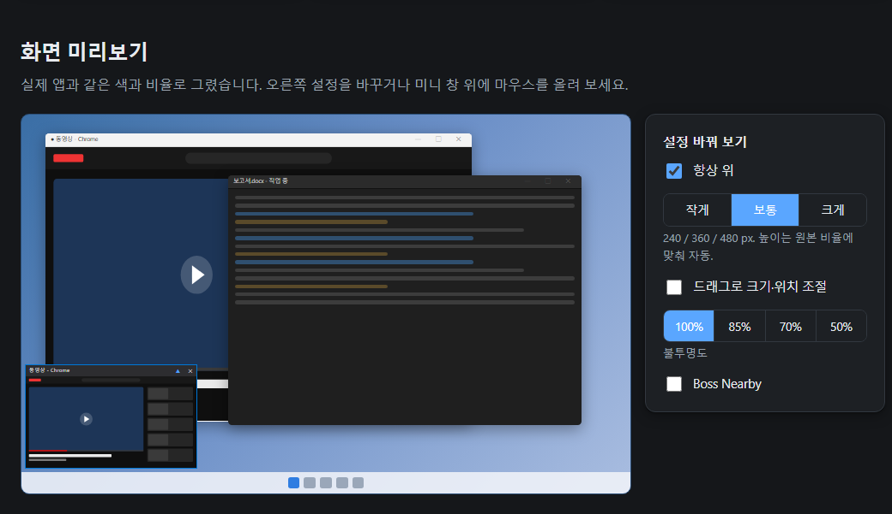
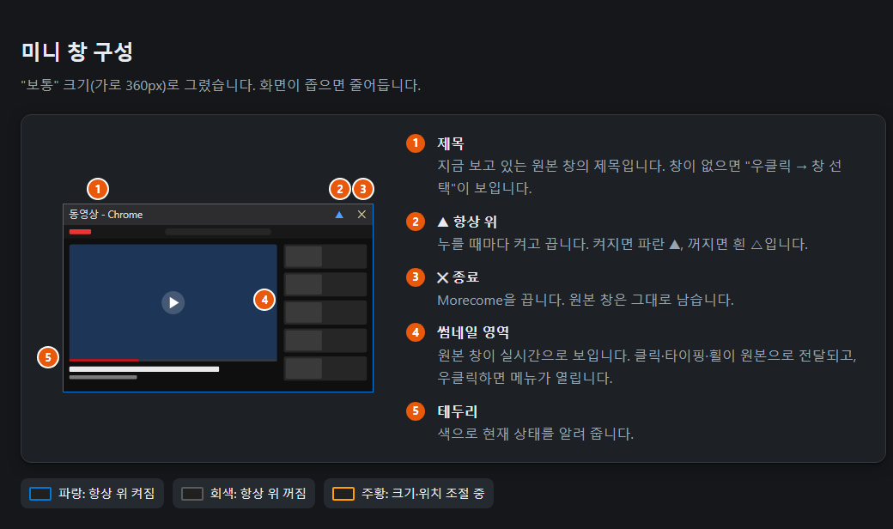
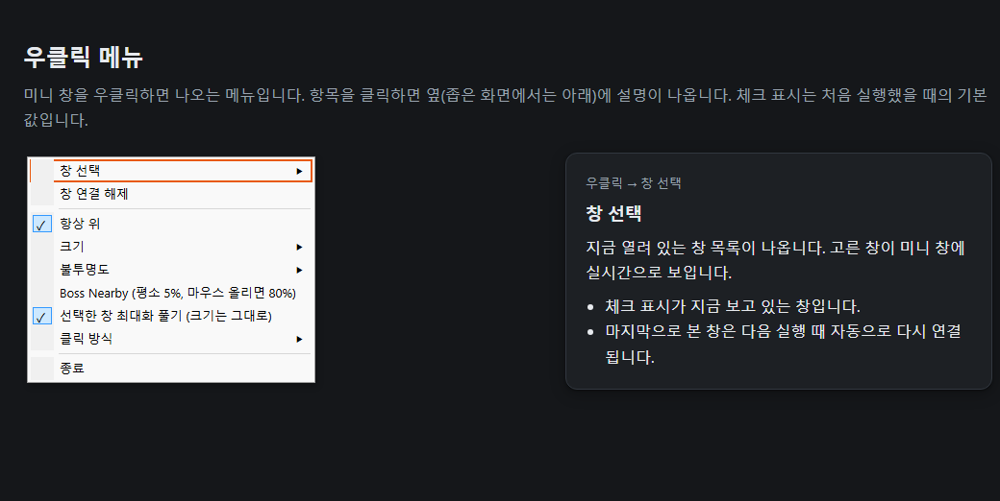
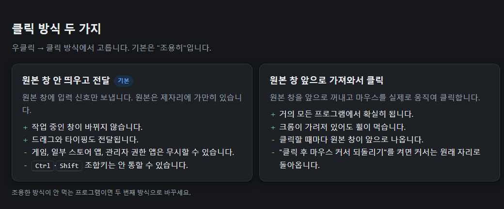

# Morecome (몰컴)

열려 있는 프로그램 창 하나를 모니터 왼쪽 아래 구석에 작게(실시간 썸네일) 띄워 두고, 그 작은 화면 안에서 클릭·타이핑하면 원본 창에 그대로 전달되는 Windows 프로그램. 원본 창은 앞으로 튀어나오지 않고 있던 자리에 그대로 있다(다른 창 뒤에 가려져 있어도 썸네일은 실시간).



## 실행

- [Releases](https://github.com/Andy-Woohol/Morecome/releases/latest)에서 `Morecome-v*.zip`을 받아 압축을 풀거나 직접 빌드한 뒤 `Morecome.exe`를 더블클릭. 설치 불필요, 다른 PC에 exe 파일만 복사해도 동작(Windows 10/11, .NET Framework 4.x 내장). zip 안에는 exe, 설명서 HTML, LICENSE가 들어 있음.
- exe는 코드 서명이 없어 브라우저나 Windows SmartScreen이 경고할 수 있음. Chrome이 다운로드를 막으면 `chrome://downloads`에서 "보관"을 누르고, SmartScreen 창이 뜨면 "추가 정보" → "실행"을 누르면 됨.
- 종료: 미니 창 오른쪽 위 `✕` 또는 우클릭 → 종료.
- 아이콘: 빌드할 때 같은 폴더에 `notepad.ico`가 있으면 exe 아이콘과 창 아이콘으로 묶임. 이 파일은 저장소에 포함하지 않으므로 원하는 `.ico`를 그 이름으로 넣고 빌드. 없으면 기본 아이콘으로 빌드됨.
- 창 제목은 "제목 없음 - 메모장"으로 표시됨.

## 사용법



| 동작 | 방법 |
|---|---|
| 보여 줄 창 고르기 | 미니 창 우클릭 → **창 선택** → 목록에서 창 클릭 |
| 원본 클릭 | 썸네일 영역을 좌클릭 / 더블클릭 / 드래그. 원본 창의 같은 지점에 전달됨 |
| 원본에 타이핑 | 썸네일을 한 번 클릭한 뒤 키보드 입력. 마지막 클릭한 지점의 컨트롤로 글자가 감 |
| 원본 스크롤 | 썸네일 위에서 마우스 휠. 크롬이 다른 창에 가려져 있으면 크롬이 휠을 무시하므로, 썸네일을 클릭한 뒤 방향키·Page Down·Space로 스크롤 |
| 항상 위 | 제목줄 `▲` 클릭 또는 우클릭 → **항상 위** (파란 테두리 = 켜짐) |
| 크기 | 우클릭 → **크기** → 작게 240 / 보통 360 / 크게 480 px (높이는 원본 비율에 맞춰 자동) |
| 크기·위치 드래그 조절 | 우클릭 → **크기** → **드래그로 크기·위치 조절** 체크. 테두리가 주황색으로 바뀌고 네 모서리에 손잡이가 생김. 아무 모서리나 끌면 반대편 모서리를 고정한 채 비율을 유지하며 크기가, 창 안이나 제목줄을 끌면 위치가 바뀜. 조절이 끝나면 다시 체크를 풀어야 클릭 전달이 됨. 조절한 크기·위치는 저장되며, 프리셋(작게/보통/크게)을 고르면 왼쪽 아래 고정으로 돌아감 |
| 불투명도 | 우클릭 → **불투명도** → 100 / 85 / 70 / 50 % |
| Boss Nearby | 우클릭 → **Boss Nearby** → **켜기**. 평소에는 5%로 거의 안 보이다가 마우스를 올리고 1초 머물면 80%로 서서히 밝아짐. 마우스가 떠나면 다시 5%로 서서히 돌아감. 지나가는 마우스에 반응하지 않도록 둔 지연이며, 같은 메뉴에서 **반응 지연**(즉시 / 0.5 / 1 / 2 / 3초), **평소 불투명도**(3 / 5 / 10 / 20 %), **마우스 올렸을 때**(50 / 70 / 80 / 100 %)를 바꿀 수 있음. 메뉴를 열어 두거나 드래그 조절 중에는 지연 없이 밝아짐 |
| 선택한 창 최대화 풀기 | 우클릭 → **선택한 창 최대화 풀기 (크기는 그대로)** 체크(기본 켜짐). 창을 선택할 때 그 창이 최대화 상태면 최대화를 풀고 작업 영역과 같은 크기·위치로 맞춤. 창을 앞으로 가져오지 않음. 크롬처럼 최대화 상태에서 가려지면 그리기를 멈추는 프로그램의 썸네일을 계속 갱신시키기 위한 것 |
| 클릭 방식 | 우클릭 → **클릭 방식** (아래 설명) |
| 연결 해제 | 우클릭 → **창 연결 해제** |



- 기본 위치는 주 모니터 왼쪽 아래(작업 표시줄 바로 위). 드래그 조절 모드로 옮기면 그 위치가 유지됨.
- 설정(항상 위, 크기, 불투명도, Boss Nearby와 그 지연·불투명도, 최대화 풀기, 클릭 방식, 마지막 창)은 `%APPDATA%\Morecome\settings.txt`에 저장되고 다음 실행 때 복원됨. 마지막에 보던 창이 같은 제목으로 아직 열려 있으면 자동으로 다시 연결.
- 원본 창이 닫히면 미니 창은 "표시할 창이 없습니다" 상태로 돌아감.

## 클릭 방식 두 가지

| 방식 | 동작 | 장단점 |
|---|---|---|
| **원본 창 안 띄우고 전달 (조용히)** — 기본 | 원본 창에 마우스·키보드 메시지를 직접 보냄. 원본은 활성화되지 않고 제자리에 있음 | 작업 흐름이 안 끊김. 드래그·타이핑도 전달. 단, 일부 프로그램(게임, 일부 스토어 앱, 관리자 권한 앱)은 메시지를 무시할 수 있고, Ctrl/Shift 조합키는 안 통할 수 있음 |
| **원본 창 앞으로 가져와서 클릭** | 원본을 활성화하고 마우스 커서를 실제로 옮겨 클릭 | 거의 모든 프로그램에서 확실히 동작. 대신 원본 창이 앞으로 나옴. "클릭 후 마우스 커서 되돌리기" 옵션 있음 |



조용한 방식이 안 먹는 프로그램이면 메뉴에서 두 번째 방식으로 바꾸면 된다.

## 제한

- 원본 창이 **최소화**되어 있으면 Windows가 썸네일을 그리지 않음(빈 화면). 창을 최소화하지 말고 다른 창 뒤에 두거나 화면 밖으로 밀어 두면 됨.
- 관리자 권한으로 실행 중인 프로그램에는 입력이 전달되지 않음(Windows 보안 정책). 그 경우 Morecome.exe도 관리자 권한으로 실행.
- 우클릭은 몰컴 메뉴용이라 원본으로 전달되지 않음.
- 크롬은 휠 신호를 받은 화면 지점이 다른 프로그램 창에 덮여 있으면 그 휠을 버림. 가려진 크롬은 키보드로 스크롤하거나 "앞으로 가져와서 클릭" 방식을 사용.
- 크롬은 창이 **최대화**된 채 다른 창에 완전히 가려지면 자체 절전 기능으로 그리기를 멈춰 썸네일(유튜브 등)이 멎음. 기본 옵션 "선택한 창 최대화 풀기"가 창 선택 시 최대화를 풀어 이를 피함. 그래도 멎으면 크롬 `chrome://flags`의 "Calculate window occlusion on Windows"를 Disabled로 두거나 유튜브 PIP(화면 속 화면)를 사용.

## 설명서

같은 폴더의 `Morecome_설명서.html`을 브라우저로 열면 화면 모형과 함께 볼 수 있음. 이 README의 그림은 그 설명서를 찍은 것이며 `docs/images`에 있음. 이 README가 원본이며 내용이 바뀌면 HTML도 함께 고침.

## 빌드

```
build.cmd
```

Windows에 내장된 C# 컴파일러(`%WINDIR%\Microsoft.NET\Framework64\v4.0.30319\csc.exe`)로 `Morecome.cs` 하나를 컴파일. Visual Studio 불필요. 저장소에는 exe가 없으므로 받은 뒤 한 번 빌드해야 함.

## 라이선스

MIT. `LICENSE` 참고.

## 동작 원리

- 썸네일: DWM 썸네일 API(`DwmRegisterThumbnail`). 화면 캡처가 아니라 창 합성기가 직접 그리므로 CPU 부담이 거의 없고 가려져 있어도 실시간.
- 조용한 전달: 썸네일 좌표 → 원본 클라이언트 좌표로 환산 → 그 지점의 자식 창을 찾아 `WM_LBUTTONDOWN/UP`, `WM_MOUSEMOVE`, `WM_MOUSEWHEEL`, `WM_KEYDOWN/WM_CHAR`를 `PostMessage`로 전달.
- 활성화 전달: 원본 창 `SetForegroundWindow` → 커서 이동 → `SendInput` 실제 클릭 → 커서 복귀.
- 문제 추적: `%APPDATA%\Morecome\debug.on` 파일을 만들어 두면 전달 좌표가 `debug.log`에 기록됨.


